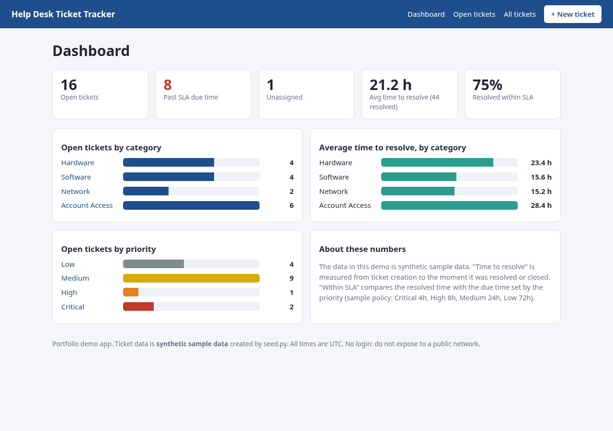
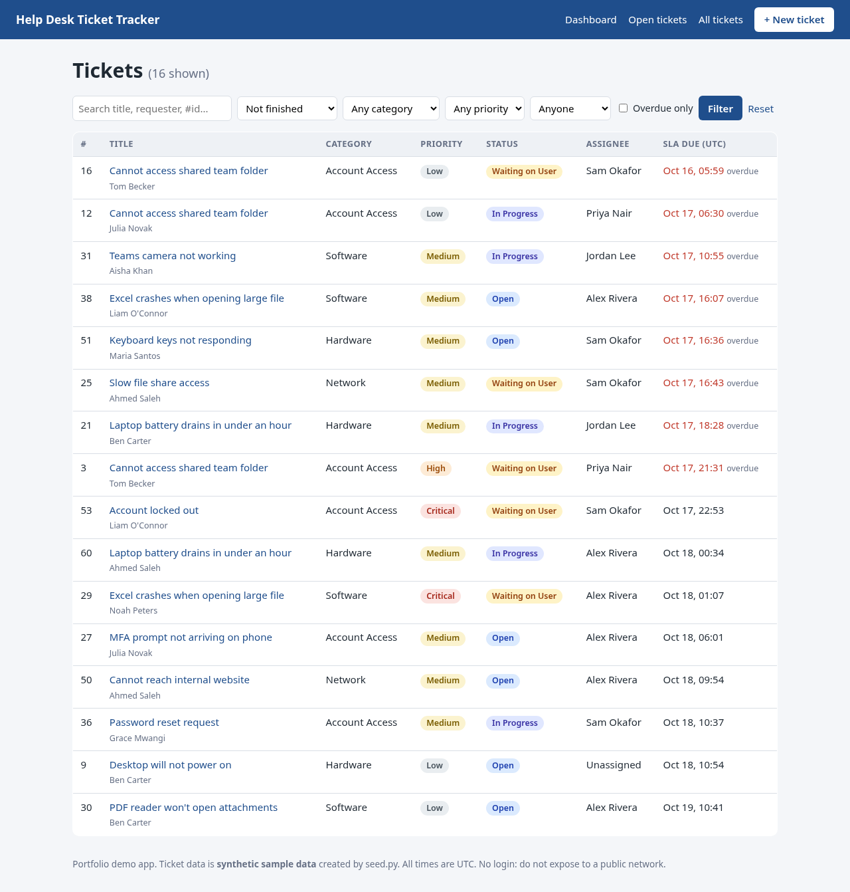
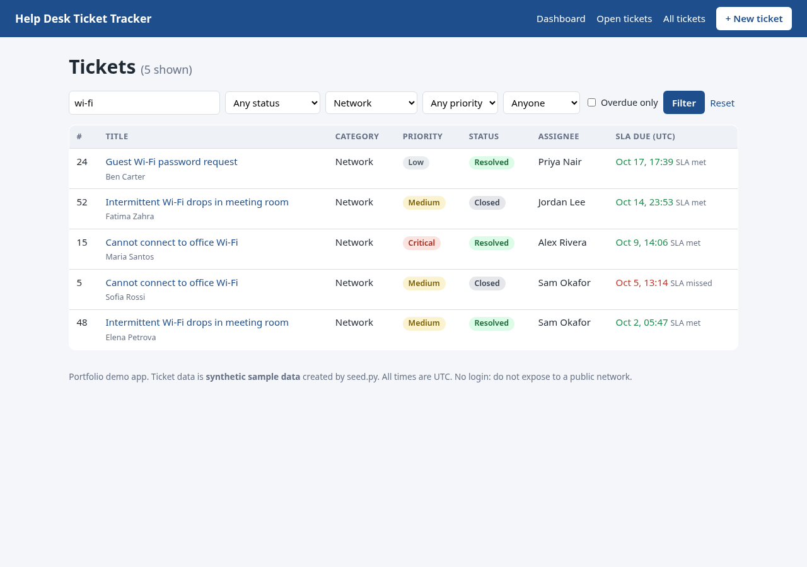
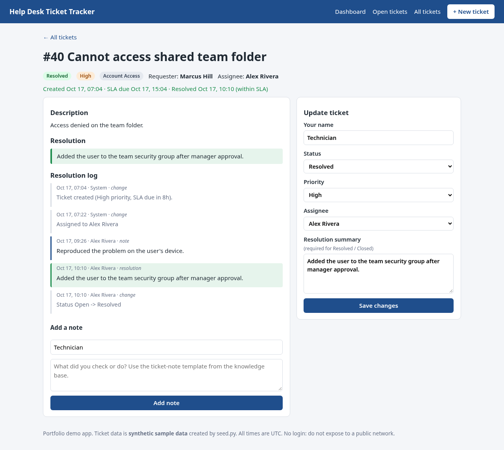
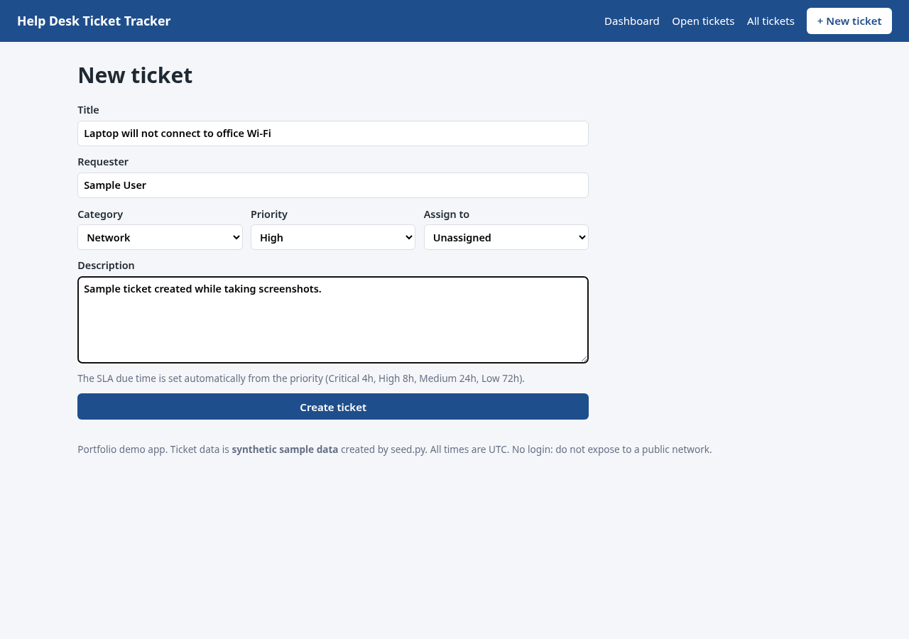

# Help Desk Ticket Tracker

A small **Flask + SQLite** web app that models the day-to-day workflow of an IT help desk: log a ticket, assign it, work it, record what you did, and close it with a resolution, while keeping an eye on the SLA clock.

**Live demo:** https://help-desk-ticket-tracker.vercel.app/ · **Repo:** https://github.com/SomarGuy/help-desk-ticket-tracker

> **All data is synthetic.** The tickets, requester names, technician names, notes and resolution times are generated by `seed.py` with a random number generator. They are not real incidents, and the dashboard figures say nothing about real-world performance. The SLA targets (Critical 4h, High 8h, Medium 24h, Low 72h) are an illustrative policy I chose for the demo.

## The problem

Help desks live and die on a few habits: every request becomes a ticket, every ticket has an owner, urgent things get a deadline, and every fix is written down so the next person (or the same person next month) can reuse it. I wanted to build the tool behind those habits to understand what a ticketing system actually has to do, instead of only using one.

## Features

- **Create tickets** with title, requester, description, category (Hardware, Software, Network, Account Access), priority (Low, Medium, High, Critical) and an optional assignee.
- **SLA due time** calculated from the priority when the ticket is created and re-calculated if the priority changes. Overdue open tickets are highlighted; resolved tickets show "SLA met" or "SLA missed".
- **Status workflow:** Open, In Progress, Waiting on User, Resolved, Closed. A ticket **cannot be resolved or closed without a resolution summary**, and re-opening a ticket clears its resolved time.
- **Resolution log:** free-text notes from technicians plus automatic entries (created, assigned, status/priority changes, resolution).
- **Search and filter** by text (title, description, requester, `#id`), status, category, priority, assignee, and "overdue only".
- **Dashboard:** open tickets by category and by priority, average time to resolve (overall and per category), tickets past their SLA due time, unassigned tickets, and the share of resolved tickets that met their SLA. All figures are computed with SQL queries in `app/stats.py`.
- **12 pytest tests** covering creation/validation, SLA calculation, workflow rules, search/filtering and the dashboard maths.

## Screenshots

These are real screenshots of the app running against the seeded sample data (taken with headless Chromium by `scripts/take_screenshots.py`). Ticket times are relative to the day the seed script ran, so the numbers you see will differ a little.

**Dashboard**


**Open tickets list, sorted by SLA due time**


**Search and filter** (text "wi-fi" + category Network)


**Ticket detail with resolution log**


**New ticket form**


## How to run it

Requires Python 3.10+.

```bash
git clone https://github.com/SomarGuy/help-desk-ticket-tracker.git
cd help-desk-ticket-tracker

python -m venv .venv
# Windows (PowerShell):  .venv\Scripts\Activate.ps1     Linux/macOS:  source .venv/bin/activate
pip install Flask pytest          # (or: pip install -r requirements.txt, which also lists Playwright)

python seed.py                    # creates instance/tickets.sqlite with 60 SYNTHETIC tickets
python run.py                     # open http://127.0.0.1:5000
```

Run the tests:

```bash
python -m pytest -q
```

Regenerate the screenshots (optional):

```bash
pip install playwright && playwright install chromium
python scripts/take_screenshots.py
```

`python seed.py --count 120 --seed 7` makes a bigger or different sample set. **Seeding deletes any existing tickets** in the database.

## Project layout

```
app/
  __init__.py     app factory + template filters
  views.py        routes: dashboard, list/search, create, detail, update, notes
  stats.py        SQL for the dashboard numbers
  constants.py    categories, priorities, statuses, SLA policy
  db.py           SQLite connection + time helpers
  schema.sql      tables: technicians, tickets, notes
  templates/ static/
seed.py           synthetic sample-data generator
run.py            development server
tests/            pytest tests (each test uses its own temporary database)
scripts/take_screenshots.py
```

## Design notes and limitations

- SQL uses parameterised queries throughout, and Jinja auto-escaping is on (there is a test that HTML in a ticket title is escaped).
- **No login, no CSRF protection, and the development server only.** This is a learning/portfolio project, not something to put on a public network. A real deployment would need authentication, CSRF tokens and a production WSGI server.
- Times are stored and shown in UTC; the SLA clock runs 24/7 (no business hours or holiday calendar).
- Technicians are a simple list; there are no user accounts, attachments, email notifications or ticket merging.

## What I learned

- Modelling a real workflow in relational tables (tickets, notes, technicians), using constraints (`CHECK`, foreign keys) to keep data valid.
- Writing SQL aggregates for a dashboard, including `julianday()` date maths for "average time to resolve".
- Enforcing business rules on the server side (no resolution means no close; changing priority recalculates the SLA) and writing automated tests to prove them.
- Using Flask's application-factory pattern so tests can run against a throw-away database.
- Why an audit trail matters: automatic log entries make it clear who changed what and when.

## Tech

Python 3, Flask, Jinja2, SQLite, SQL, HTML/CSS (no framework), pytest, Playwright (screenshots only), Git.

## Licence

MIT, see [LICENSE](LICENSE).
