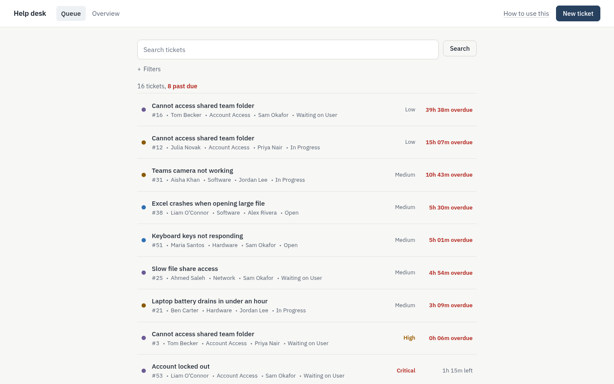
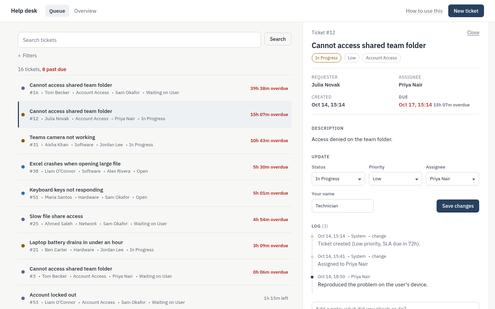
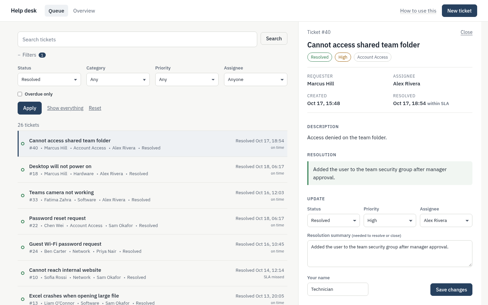
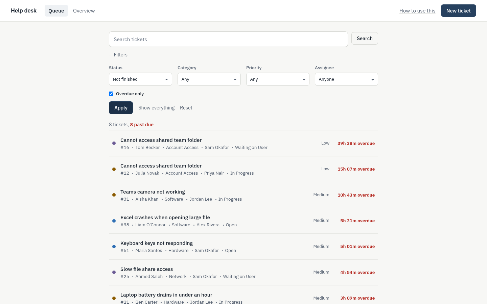
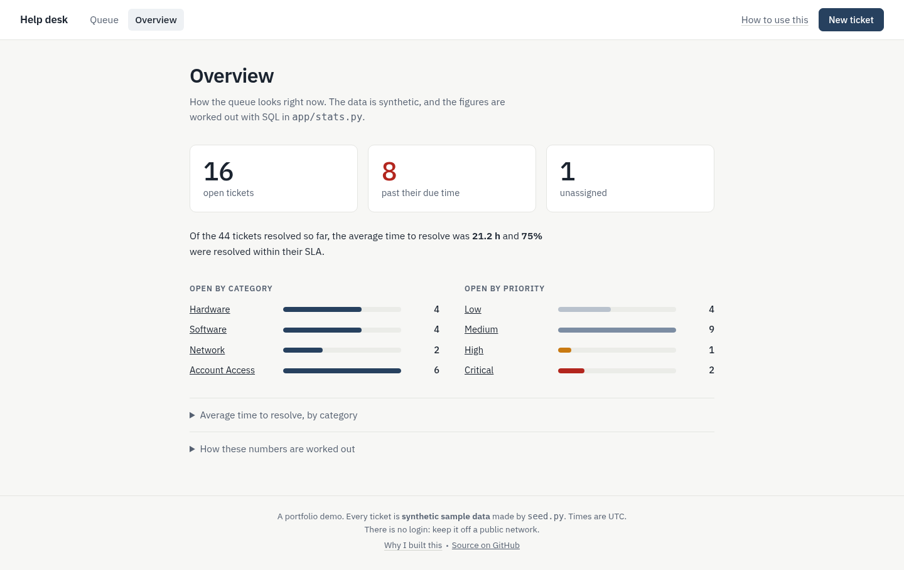
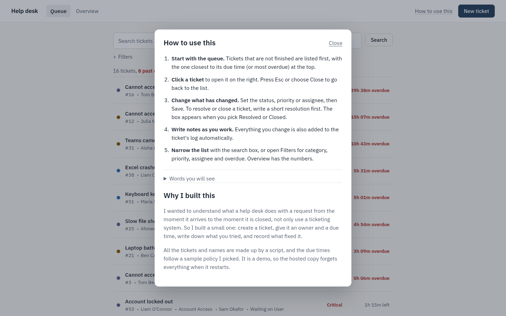
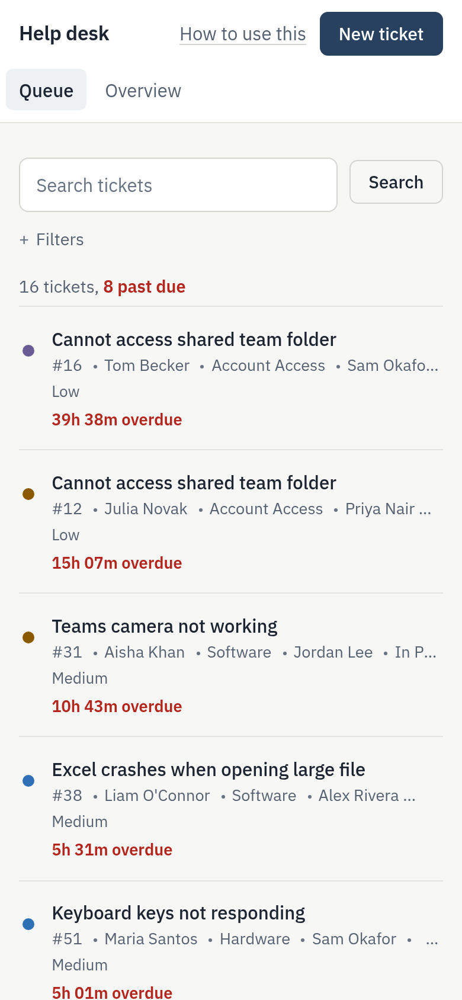
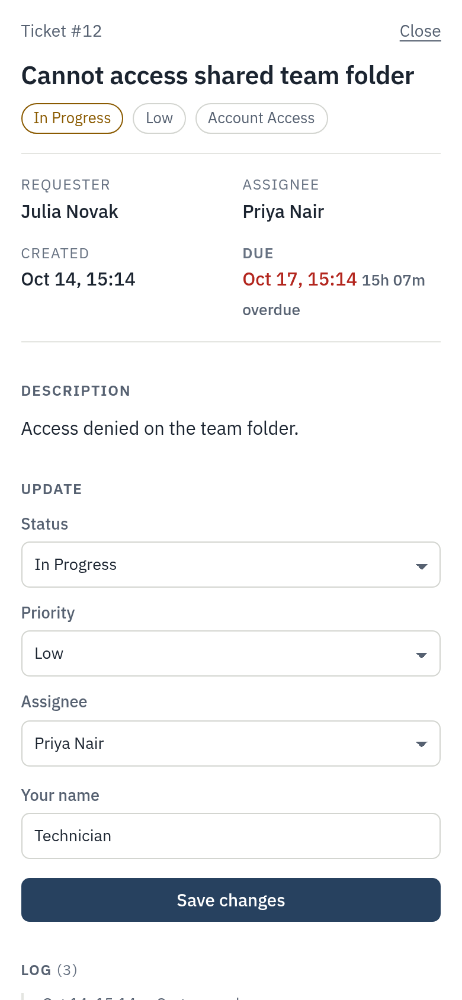

# Help Desk Ticket Tracker

A small **Flask + SQLite** web app, built around a single queue, that models the day-to-day workflow of an IT help desk: log a ticket, assign it, work it, record what you did, and close it with a resolution, while keeping an eye on the SLA clock.

**Live demo:** https://help-desk-ticket-tracker.vercel.app/ · **Repo:** https://github.com/SomarGuy/help-desk-ticket-tracker

> **All data is synthetic.** The tickets, requester names, technician names, notes and resolution times are generated by `seed.py` with a random number generator. They are not real incidents, and the figures say nothing about real-world performance. The SLA targets (Critical 4h, High 8h, Medium 24h, Low 72h) are an illustrative policy I chose for the demo.

## The problem

Help desks live and die on a few habits: every request becomes a ticket, every ticket has an owner, urgent things get a deadline, and every fix is written down so the next person (or the same person next month) can reuse it. I wanted to build the tool behind those habits to understand what a ticketing system actually has to do, instead of only using one.

## What it looks like

One list, one ticket at a time. The queue is the home page; click a ticket and it opens beside the list.





<details>
<summary>More screenshots</summary>

**A resolved ticket, with its resolution and log**


**Filtered to overdue tickets**


**Overview (the numbers)**


**The optional "How to use this" panel**


**On a phone**

 

</details>

Ticket times are relative to the day the seed script ran, so the numbers you see will differ a little. The screenshots come from `scripts/take_screenshots.py`.

## How to use it

There is a "How to use this" link in the top bar that opens the same steps in a small panel, with a short glossary. In short:

1. **Start with the queue.** Tickets that are not finished are listed first, most urgent at the top.
2. **Click a ticket** to open it on the right. Esc or Close takes you back to the list.
3. **Change what has changed:** status, priority or assignee, then Save. To resolve or close a ticket, write a short resolution first.
4. **Write notes as you work.** Every change is also added to the log automatically.
5. **Narrow the list** with the search box or the Filters. Overview has the numbers.

## Why I built this

I wanted to understand what a help desk does with a request from the moment it arrives to the moment it is closed, not only use a ticketing system. So I built a small one: create a ticket, give it an owner and a due time, write down what you tried, and record what fixed it. The tickets and names are all made up by a script, and the SLA times are a sample policy I picked.

## Features

- **Create tickets** with title, requester, description, category (Hardware, Software, Network, Account Access), priority (Low, Medium, High, Critical) and an optional assignee.
- **SLA due time** calculated from the priority when the ticket is created and re-calculated if the priority changes. Overdue open tickets are shown in red; resolved tickets show whether they were on time.
- **Status workflow:** Open, In Progress, Waiting on User, Resolved, Closed. A ticket **cannot be resolved or closed without a resolution summary**, and re-opening a ticket clears its resolved time.
- **Resolution log:** free-text notes from technicians plus automatic entries (created, assigned, status/priority changes, resolution).
- **Search and filter** by text (title, description, requester, `#id`), status, category, priority, assignee, and "overdue only". The queue shows unfinished tickets by default; "Show everything" includes resolved ones.
- **Overview:** open tickets by category and by priority, average time to resolve, tickets past their due time, unassigned tickets, and the share of resolved tickets that met their SLA. All figures are computed with SQL in `app/stats.py`.
- **Works without JavaScript.** Every ticket is also its own page (`/tickets/12`) and every form posts normally. The JavaScript only adds the side panel and refreshes the list in place.
- **Tests:** pytest tests for creation and validation, SLA calculation, workflow rules, search and filtering, the queue and its page fragments, and the overview maths, plus Playwright browser tests for the side panel, filters, forms and the help panel.

## How to run it

Requires Python 3.10+.

```bash
git clone https://github.com/SomarGuy/help-desk-ticket-tracker.git
cd help-desk-ticket-tracker

python -m venv .venv
# Windows (PowerShell):  .venv\Scripts\Activate.ps1     Linux/macOS:  source .venv/bin/activate
pip install Flask pytest          # (or: pip install -r requirements.txt, which also lists Playwright)

python seed.py                    # creates instance/tickets.sqlite with 60 SYNTHETIC tickets
python run.py                     # open http://127.0.0.1:5000
```

Run the tests (the browser tests are skipped if Playwright or a browser is not installed; set `CHROME_PATH` to use an installed Chrome):

```bash
python -m pytest -q
```

Regenerate the screenshots (optional):

```bash
pip install playwright && playwright install chromium
python scripts/take_screenshots.py
scripts/sync_vercel_bundle.py   rebuilds vercel-deploy/ (the hosted copy) from app/
vercel-deploy/    generated: what runs on Vercel (database in /tmp, reseeded on cold start)
```

`python seed.py --count 120 --seed 7` makes a bigger or different sample set. **Seeding deletes any existing tickets** in the database.

## Project layout

```
app/
  __init__.py     app factory + template filters
  views.py        routes: queue, overview, list/search, create, detail, update, notes
  stats.py        SQL for the dashboard numbers
  constants.py    categories, priorities, statuses, SLA policy
  db.py           SQLite connection + time helpers
  schema.sql      tables: technicians, tickets, notes
  templates/      workspace.html (queue + side panel), _queue, _detail, _new, dashboard
  static/         style.css, app.js, fonts/ (IBM Plex Sans, bundled; no external requests)
seed.py           synthetic sample-data generator
run.py            development server
tests/            pytest tests (each test uses its own temporary database)
scripts/take_screenshots.py
scripts/sync_vercel_bundle.py   rebuilds vercel-deploy/ (the hosted copy) from app/
vercel-deploy/    generated: what runs on Vercel (database in /tmp, reseeded on cold start)
```

## Design notes and limitations

- SQL uses parameterised queries throughout, and Jinja auto-escaping is on (there is a test that HTML in a ticket title is escaped).
- **No login, no CSRF protection, and the development server only.** This is a learning/portfolio project, not something to put on a public network. A real deployment would need authentication, CSRF tokens and a production WSGI server.
- Times are stored and shown in UTC; the SLA clock runs 24/7 (no business hours or holiday calendar).
- Technicians are a simple list; there are no user accounts, attachments, email notifications or ticket merging.
- The hosted demo keeps its database in `/tmp`, so tickets you create there disappear when the server restarts.

## What I learned

- Modelling a real workflow in relational tables (tickets, notes, technicians), using constraints (`CHECK`, foreign keys) to keep data valid.
- Writing SQL aggregates for a dashboard, including `julianday()` date maths for "average time to resolve".
- Enforcing business rules on the server side (no resolution means no close; changing priority recalculates the SLA) and writing automated tests to prove them.
- Using Flask's application-factory pattern so tests can run against a throw-away database.
- Why an audit trail matters: automatic log entries make it clear who changed what and when.

## Tech

Python 3, Flask, Jinja2, SQLite, SQL, HTML, CSS and a little vanilla JavaScript (no framework), pytest, Playwright (browser tests and screenshots), Git.

## Licence

MIT, see [LICENSE](LICENSE).
